

  <a href="https://surface3d.site">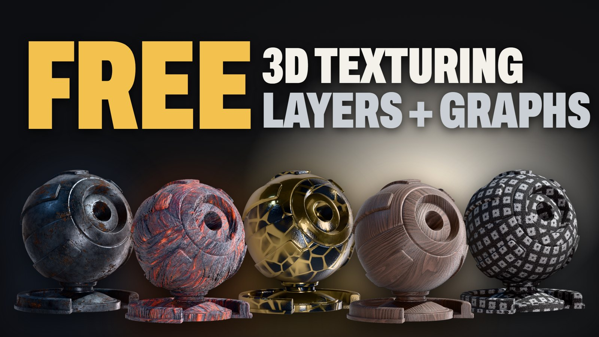</a>

<h1 align="center">Surface3D</h1>

  <b>Free 3D texture painting for Windows and Linux.</b> 
  Layers when you paint. Nodes when you need them.

  
  
  
  

  <a href="https://github.com/moaref1/Surface3D/releases/latest"><b>Download</b></a> ·
  <a href="https://surface3d.site">Website</a> ·
  <a href="https://surface3d.site/docs.html">Documentation</a> ·
  <a href="https://discord.gg/K3YzGP72cg">Discord</a> ·
  <a href="https://www.paypal.com/donate/?hosted_button_id=SFRZK6K2A957J">Donate</a>

---

Surface3D is a GPU texture painter for game and film assets. Paint materials onto your models in a
layer stack, open any layer as a node graph when you want procedural control, bake mesh maps, sculpt
detail straight into the normal map and export PBR textures for your engine.

**Free for individuals**: students, hobbyists and freelancers, paid client work included. It's the full app, not a trial.
Teams and studios need a [Studio License](#licensing).

  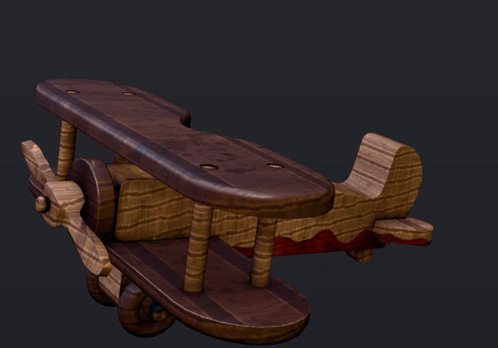

> **Early access.** Surface3D is used every day and new versions come out often, but it is still young.
> Expect rough edges, and please [report what you find](https://github.com/moaref1/Surface3D/issues).

## Contents

- [What makes it different](#what-makes-it-different)
- [Features](#features)
- [Workspaces](#workspaces)
- [Download](#download)
- [Licensing](#licensing)
- [Community and support](#community-and-support)

## What makes it different

<table>
<tr>
<td width="50%" valign="top">

### Every layer is a node graph
Paint in layers the way you always have. When you need procedural control, open a layer, mask or
effect as a graph. There are **220+ nodes in 12 families**, and every result flows straight back into the stack.

</td>
<td width="50%" valign="top">

### Sculpt straight into the normal map
Dent, fold, carve and inflate the surface in a live Sculpt layer. Cloth brushes add folds, tufts and
stitches. **You don't need a high-poly mesh or a bake.**

</td>
</tr>
<tr>
<td valign="top">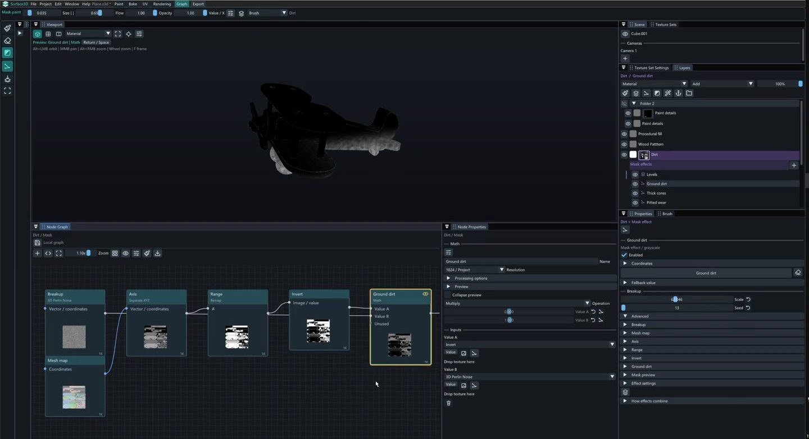</td>
<td valign="top">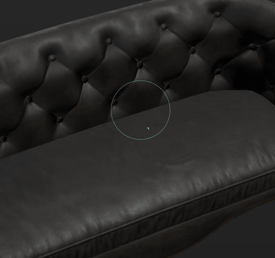</td>
</tr>
<tr>
<td width="50%" valign="top">

### Teach Mask: paint a few strokes, it learns the rest
Left-click where an effect should go, right-click where it shouldn't. Surface3D learns the rule from
your strokes, the baked maps and the surface, then fills the whole model: moss in the cracks, rust on the edges,
dirt where it collects.

</td>
<td width="50%" valign="top">

### Drips and particles that follow the shape
Particle brushes run a small simulation as you paint. Drops fly, fall, run down the surface and leave
paint where they settle. Use them for drips, leaks, splatter and dust.

</td>
</tr>
<tr>
<td valign="top">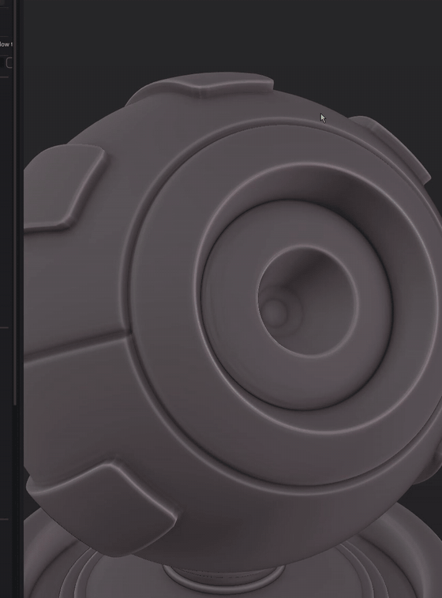</td>
<td valign="top">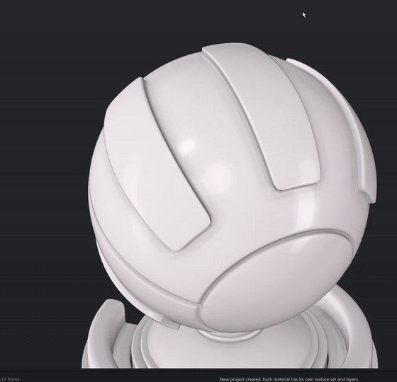</td>
</tr>
</table>

  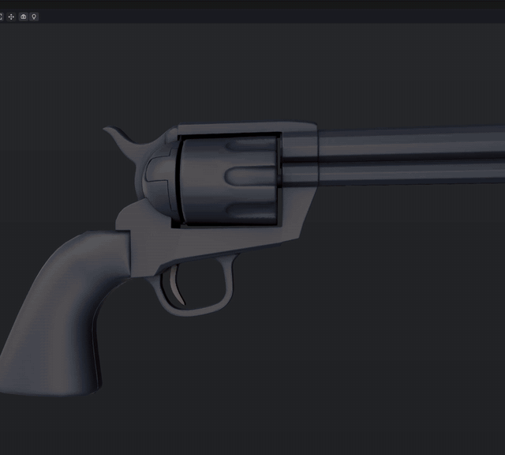 
  From a grey mesh to a worn revolver, sped up.

## Features

#### Painting and layers
- **Layer stack** with paint, fill, procedural, sculpt and spline layers, folders, sub-layers, effects and masks. Blend modes, opacity, lock, solo, color-coded folders, Ctrl+G grouping and anchor points that reuse a result further up the stack.
- **Channels**: base color, roughness, metallic, height, normal, emission, opacity and more, each painted and filled like any other.
- **Brushes**: brush, eraser, smudge, blur, clone stamp, fill, eyedropper and decals. Image tips, pen pressure, smoothing, symmetry and stencils (hold S to place them). Graphics-tablet pressure works on Windows and Linux.
- **Gradients everywhere**: color, roughness and metallic as 2–16-stop gradients (linear, radial, angular, diamond, reflected, square), on layers, in the graph and along a brush stroke.
- **Spline strokes**: draw a curve on the model and paint along it, for stitches, seams, cables and trims. The curve stays editable.
- **Particle brushes** and a **physics brush** node that simulates water flow and dirt moving over the surface.

#### Masks, generators and weathering
- **26 smart generators** (edge wear, dirt, dust, rust, leaks and more) driven by curvature, AO and normal-map detail. Each has clear parameters, a random seed and a material-ball preview.
- **20 procedural grunges**, and any generator can swap its grunge for a project texture or an online map.
- **Teach Mask** (paint by example) for dirt, rust, dust, moss and more, with drips that run down from the edges you paint.
- **Edge damage and bevels without a high-poly bake**: soft, rounded edges and chipped paint on the low-poly mesh. Smart masks follow your sculpting and edge damage just as they would follow a bake.
- **Layer filters** (blur, slope blur, levels, contrast, invert and more) on paint layers, fills and masks.

#### Node graph
- **220+ nodes** in 12 families: inputs, coordinates, patterns and noise, scatter and tiles, paths, color, filters, normals and height, masks, materials, utilities and outputs.
- Live previews on every node, including while you drag a value. Mode menus and image pickers sit right on the node cards. You can type values beyond the slider range.
- Drag online textures, generators and grunges straight into the graph. Nested graphs work as reusable functions with named outputs.
- Every node is documented in the [searchable node reference](https://surface3d.site/docs.html).

#### Baking
- **Normal, ambient occlusion, curvature, thickness, position, bent normal and ID** maps.
- **High to low in one click**: pick the low mesh, the high mesh and the size. Parts are paired for you, and the Bake panel shows any spots that need attention. You can see and paint the cage.
- **Dense high-poly meshes** (millions of triangles) load in the background. Baking uses hardware ray tracing where your card has it and fast compute where it doesn't.

#### Materials and library
- **ambientCG and Poly Haven built in**: thousands of free CC0 materials, textures and HDRIs. Drag one onto the model or a layer, and choose 1K, 2K or 4K as you drop it.
- Your own library: material spheres for every fill, searchable grids, and reusable layers and folders that keep their exposed controls.

#### Shaders, rendering and export
- **Per-texture-set shaders**: Skin (subsurface scattering and light through thin parts), Foliage / thin, Clear coat and Custom.
- **Rendering workspace**: cameras, lights, HDRI environments, turntable, depth of field and post-processing. Live ray tracing adds soft shadows, reflections and bounce light, even on 4K projects.
- **Export presets** for Unreal Engine, Unity HDRP and glTF / Blender, or your own channel packing, such as AO-roughness-metallic in one ORM texture. File names follow a pattern you set.

#### Everyday use
- **UV editor**: inspect islands, unwrap and pack. Fill layers can use triplanar and other projections where the UVs are tight.
- **Fast at 4K**: smooth on graphics cards with 8 GB, comfortable at 2K on an entry-level GPU. The app is about 20 MB.
- **Natural navigation**: orbit around the point you click, zoom toward the surface under the cursor, and pan by grabbing the model.
- **Ctrl+K command search**, autosave and crash recovery, built-in updates, and 13 interface languages, including Persian and Arabic (right-to-left).

## Workspaces

<table>
<tr>
<td width="50%">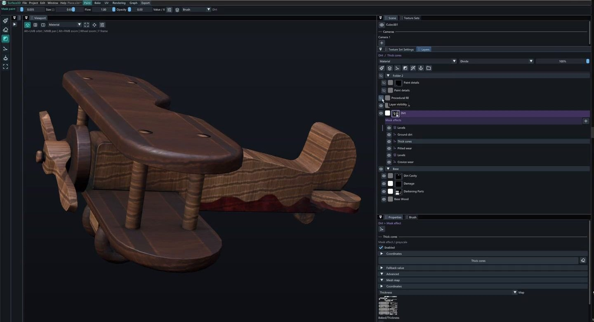 <b>Paint</b>: layers, masks and effects at 2K and 4K.</td>
<td width="50%">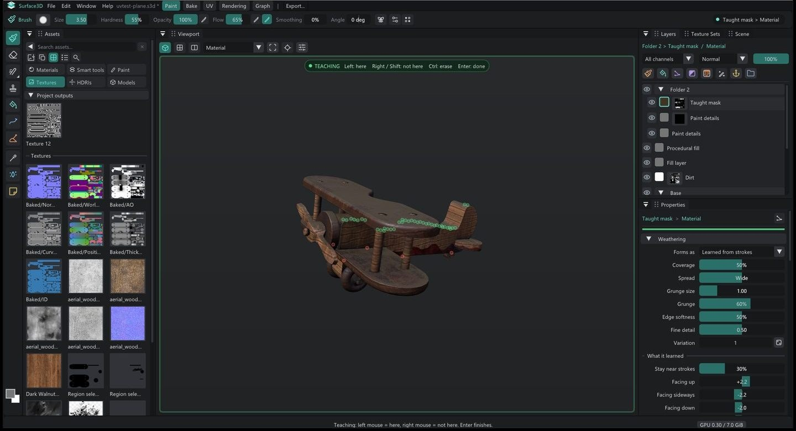 <b>Weathering</b>: Teach Mask learning from a few strokes.</td>
</tr>
<tr>
<td>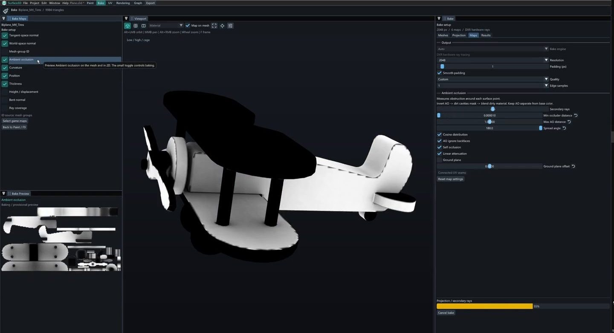 <b>Bake</b>: mesh maps from the model or a high-poly mesh.</td>
<td>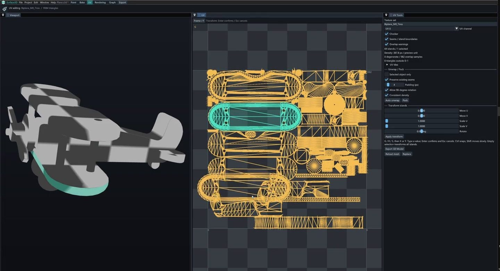 <b>UV</b>: islands next to a checkered preview.</td>
</tr>
<tr>
<td> <b>Graph</b>: the node graph behind any layer.</td>
<td>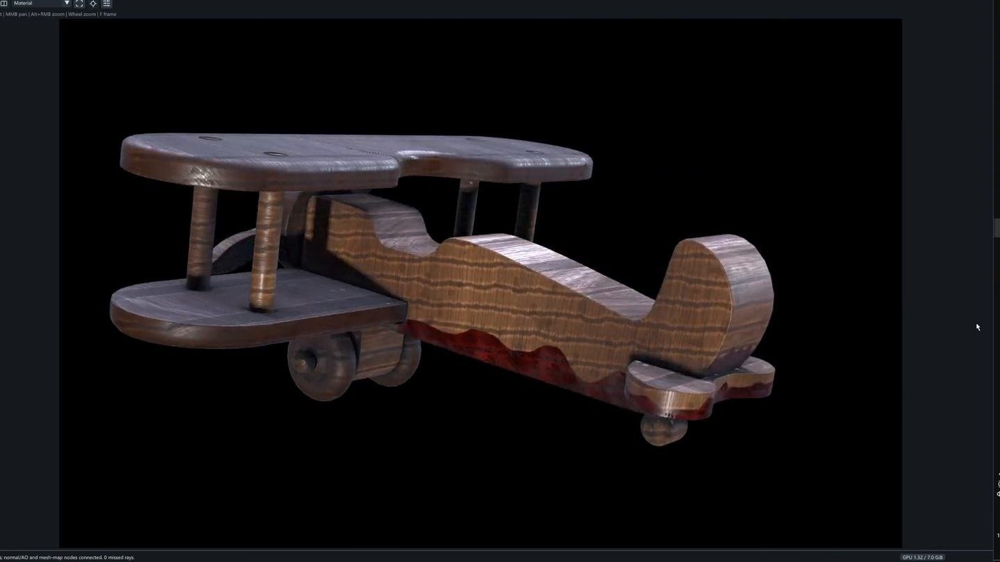 <b>Rendering</b>: lights, HDRIs and turntables.</td>
</tr>
</table>

  <a href="https://www.youtube.com/watch?v=ch42iDu6474">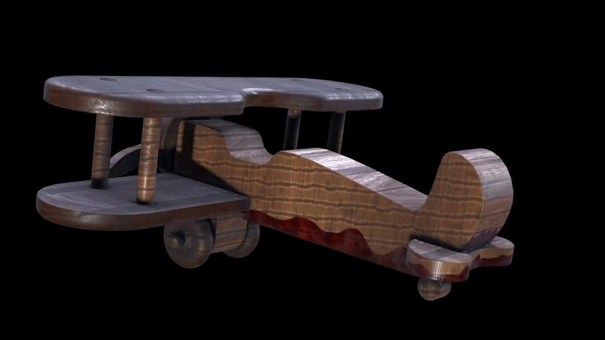</a> 
  ▶ <a href="https://www.youtube.com/watch?v=ch42iDu6474">Watch the demo on YouTube</a>: layers and nodes, sculpting into the normal map, bevels and Teach Mask.

## Download

Get the newest version from **[Releases](https://github.com/moaref1/Surface3D/releases/latest)**.

| | File | How to run |
|---|---|---|
| **Windows** 10 / 11, 64-bit | `Surface3D-<version>-Windows-x64.zip` | Unzip it (it doesn't run from inside the ZIP), then run `Surface3D.exe`. Keep the files in that folder together. |
| **Linux** x86_64 (beta) | `Surface3D-<version>-x86_64.AppImage` | `chmod +x Surface3D-*.AppImage`, then run it. It needs a Vulkan driver. |

**Graphics card:** any recent GPU with an up-to-date driver. Surface3D uses Vulkan and falls back to
Direct3D 11 by itself. Hardware ray tracing is used when it's available, and 8 GB of video memory is
enough for smooth 4K.

**Updates:** the app tells you when a new version is out and installs it into the same folder
(**File > Check for updates**). Projects from older versions open normally.

New here? Start with [Getting started](https://surface3d.site/docs.html) and *Your first texture* in the documentation.

## Licensing

| | Personal | Studio |
|---|---|---|
| Who | Individuals working alone: hobby, students, teachers, freelancers (paid client work included) | Companies, studios and teams: 2 or more people, or installed on company computers |
| Price | **Free** | **One-time, per seat** (no subscription) Indie studio, 2-10 seats: ~~$149~~ **$59** Studio, 11+ seats: ~~$299~~ **$119** Large / AAA studios: contact for a quote |
| Commercial use of your work | Yes | Yes |
| Updates | All, free | 1 year included, keep that version forever. Optional renewal: $59 per seat / year |
| Priority support | - | Yes |

**Early access: 60% off Studio licenses for early buyers** (prices above already include it).

- Studios can evaluate Surface3D for 30 days before buying.
- Schools and non-profits: ask for a free or reduced Studio License.
- To buy a Studio License, open a [Studio License request](https://github.com/moaref1/Surface3D/issues/new?title=Studio%20License%20request&labels=license)
  with your studio name and number of seats. You get an invoice and a license certificate.

Full terms: [LICENSE.txt](LICENSE.txt). Third-party component licenses are in the `licenses` folder of each release.
The application source is private; this repository holds the official releases, release notes and bug reports.

## Community and support

- **[Discord](https://discord.gg/K3YzGP72cg)**: questions, renders, feedback and early news. What comes next is shaped there.
- **[Issues](https://github.com/moaref1/Surface3D/issues)**: bug reports and feature ideas. Please include your app version, operating system, graphics card and the steps to reproduce the problem.
- **[Documentation](https://surface3d.site/docs.html)**: guides and the full node reference.

If Surface3D helps your work, a donation keeps it going:

  

Bundled HDRIs and materials come from Poly Haven and ambientCG (CC0). Unreal Engine, Unity and Blender are trademarks of their owners; Surface3D isn't affiliated with them.
